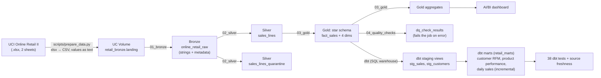
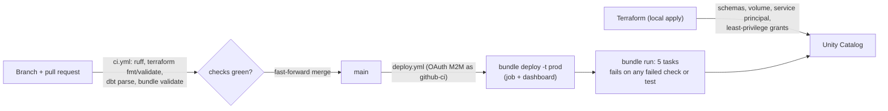
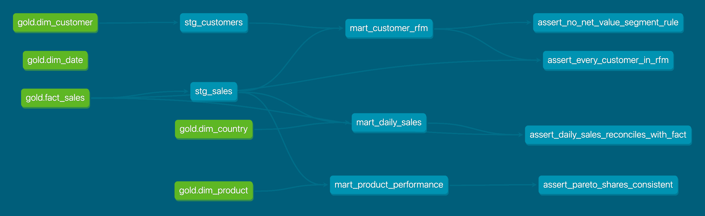

# Retail Medallion Pipeline on Databricks

[](https://github.com/carlosgraterolp/retail-medallion-databricks/actions/workflows/ci.yml)
[](https://github.com/carlosgraterolp/retail-medallion-databricks/actions/workflows/deploy.yml)

An end-to-end batch pipeline on **Databricks Free Edition** that takes ~1.07M real e-commerce
invoice lines through a **Medallion architecture** (bronze → silver → gold), models the gold layer
as a **Kimball star schema**, validates it with automated **data quality checks**, builds
business-facing **dbt marts** (customer RFM segments, product Pareto, an incremental daily mart) on
top of it, and serves a small **AI/BI dashboard**. Platform resources are managed with
**Terraform**; the job (including the dbt task) and the dashboard with a **Declarative Automation
Bundle** (`databricks.yml`, formerly "Databricks Asset Bundles"). **GitHub Actions** checks every pull
request and, on `main`, deploys and runs the pipeline as a service principal, failing if any
quality check or dbt test fails.


Stack: PySpark, Spark SQL, Delta Lake, Unity Catalog, Lakeflow Jobs (serverless), dbt Core
(dbt-databricks), Terraform (Databricks provider), Declarative Automation Bundles, GitHub Actions,
Databricks CLI, Databricks AI/BI dashboards, ruff.

## Problem

The UCI *Online Retail II* dataset holds every transaction of a UK-based online gift retailer between
2009-12-01 and 2011-12-09. The raw data has the problems real sources have: two files that overlap
in time, exact duplicate lines, cancellations mixed with sales, 23% of lines without a customer,
stock adjustments and bad-debt write-offs that are not sales, inconsistent casing and several
descriptions per product code. The goal is a trustworthy, query-ready model of sales, where every
rejected row can be accounted for.

## Architecture



Delivery and infrastructure:



All of it runs as one Lakeflow Job with five serverless tasks:
`bronze → silver → gold → quality_checks → dbt_marts` (four notebooks, then a dbt task that runs
`dbt source freshness` and `dbt build` on the SQL warehouse).

## Results of the last full run

| Layer | Table | Rows |
|---|---|---|
| Bronze | `retail_bronze.online_retail_raw` | 1,067,371 (525,461 + 541,910 from the two sheets) |
| Silver | `retail_silver.sales_lines` | 1,027,015 |
| Silver | `retail_silver.sales_lines_quarantine` | 6,209 |
| (removed) | exact duplicates | 34,147 |
| Gold | `fact_sales` | 1,027,015 |
| Gold | `dim_product` / `dim_customer` / `dim_country` / `dim_date` | 4,760 / 5,940 / 44 / 1,095 |
| Marts (dbt) | `mart_customer_rfm` / `mart_product_performance` / `mart_daily_sales` | 5,939 / 4,738 / 3,237 |

`bronze = silver + quarantine + duplicates` (1,027,015 + 6,209 + 34,147 = 1,067,371) is asserted on
every run. **33 of 33** quality checks passed. In the last CI deployment (GitHub Actions, as the
service principal) the whole workflow took 3 min 34 s: bronze 14 s, silver 19 s, gold 46 s, checks
30 s, dbt 61 s; in the dbt task, source freshness passes and 43 of 43 dbt nodes pass (5 models and
38 tests).

## Tables

All tables are Delta tables in Unity Catalog, catalog `workspace` (the default catalog in Free Edition).

### Bronze: `retail_bronze`
| Table | Grain | Key | Description |
|---|---|---|---|
| `online_retail_raw` | one row per source CSV row | none | All 8 source columns as **strings**, plus `_source_file` and `_ingested_at`. Only the column names are changed (snake_case), because Delta column names cannot contain spaces without column mapping. Full overwrite on every run. |

### Silver: `retail_silver`
| Table | Grain | Key | Description |
|---|---|---|---|
| `sales_lines` | one invoice line | `line_id` (SHA-256 of all business columns) | Typed, trimmed, upper-cased codes, valid and deduplicated. Flags: `is_cancelled`, `is_guest`, `is_non_merchandise`. `line_amount = quantity × unit_price` (negative for cancellations). |
| `sales_lines_quarantine` | one rejected source row | none | Every row that failed at least one rule, with the array `failed_rules` and `_quarantined_at`. |

### Gold: `retail_gold` (star schema)
| Table | Grain | Keys | Description |
|---|---|---|---|
| `fact_sales` | **one invoice line** | `line_id`; FKs `date_key`, `product_key`, `customer_key`, `country_key` | Measures: `quantity`, `unit_price`, `line_amount`. `invoice_no` is a degenerate dimension. Liquid clustering on `date_key`. |
| `dim_product` | one stock code | SK `product_key` (identity), NK `stock_code` | Latest description, `is_non_merchandise`, first/last sold date. SCD Type 1. |
| `dim_customer` | one customer | SK `customer_key` (identity), NK `customer_id` | Latest country, first/last purchase date. SCD Type 1. `-1` = guest/unknown. |
| `dim_country` | one country | SK `country_key` (identity), NK `country_name` | Country of the invoice (works for guest sales too). |
| `dim_date` | one calendar day | `date_key` (`yyyymmdd`) | Generated calendar 2009-01-01 to 2011-12-31. |
| `agg_monthly_revenue_by_country` | month × country | `year_month`, `country_name` | Gross sales, cancelled amount, net revenue, invoices, customers. |
| `agg_top_products` | one merchandise product | `product_key` | Net revenue, net units, invoices, `revenue_rank`. Postage, fees and adjustments are excluded. |
| `agg_monthly_cancellation_rate` | month | `year_month` | Gross sales, cancelled amount, `cancellation_rate = cancelled / gross`. |
| `dq_check_results` | check × run | `run_ts`, `check_name` | Audit trail of every quality check run (appended). |

Every dimension has an **unknown member** with key `-1`, so fact foreign keys are never NULL.

## Data quality rules

### Silver validation (a failing row goes to quarantine, with every rule it failed)
| Rule | Condition | Rows (last run) | Why |
|---|---|---|---|
| `zero_price` | `unit_price = 0` | 6,202 | Free items and stock adjustments, not sales |
| `negative_qty_not_cancelled` | `quantity < 0` on a non-`C` invoice | 3,457 | Stock write-offs ("damaged", "lost"…) |
| `invalid_invoice_no` | not `^C?[0-9]{6}$` | 6 | "A" invoices = bad-debt adjustments |
| `invalid_price` | NULL or `< 0` | 5 | Same bad-debt adjustments |
| `positive_qty_cancelled` | `quantity > 0` on a `C` invoice | 1 | Contradictory record |
| `missing_invoice_no`, `missing_stock_code`, `invalid_invoice_date`, `invalid_quantity`, `invalid_customer_id`, `missing_country` | NULL or unparseable | 0 | Type and completeness guards |

The counts overlap (one row can fail several rules); 6,209 distinct rows are quarantined.

### Handled explicitly, not rejected
- **Cancellations** (invoice starting with `C`, 19,103 lines in silver): kept and flagged with `is_cancelled`. They carry negative quantities, so net revenue nets them out and the cancellation rate measures them.
- **Missing Customer ID** (229,200 silver lines, 22%): kept as guest sales (`is_guest`), mapped to the `-1` "Unknown" customer in gold.
- **Duplicates** (34,147): exact duplicates on all business columns, mostly from the two source sheets overlapping on 2010-12-01 to 2010-12-09. *Assumption*: the source has no line number, so two identical lines on the same invoice at the same second are treated as one.
- **Non-merchandise codes** (POST, DOT, M, BANK CHARGES, AMAZONFEE, gift vouchers…): kept as revenue, flagged, and excluded from the top-products ranking.
- **Several descriptions per stock code**: `dim_product` keeps the latest non-empty one (SCD1).

### Quality checks (`04_quality_checks`, 33 checks)
- Row counts: bronze and silver not empty; silver + quarantine ≤ bronze; fact rows = silver rows.
- Silver rules enforced: no zero/negative prices, no zero quantity, no cancelled line with positive quantity, `line_id` unique.
- Null checks on all fact keys; uniqueness of every surrogate and natural key; unknown member present.
- Referential integrity: no orphan fact rows against any of the four dimensions; only guest lines point to the unknown customer.
- Revenue reconciliation: silver = fact = monthly-by-country aggregate = cancellation-rate aggregate.

Results are appended to `dq_check_results`. If any check fails, the notebook raises an
`AssertionError` and the job run fails. This was tested by inserting one orphan row into
`fact_sales`: 3 of 33 checks failed (row count, referential integrity, revenue) and the run was
marked FAILED. The next full run rebuilt the fact and all checks passed.

## How to deploy and run

Requirements: a Databricks Free Edition workspace, Databricks CLI v1.28.0 and Terraform 1.17.2 (the
versions this was built and tested with), Python 3 (only to convert the source file).

```bash
# 1. Authenticate (OAuth in the browser; credentials stay in ~/.databrickscfg)
databricks auth login --host https://<your-workspace>.cloud.databricks.com --profile retail

# 2. Get the data and convert the two Excel sheets to CSV (values kept as text)
mkdir -p data/raw
curl -L -o data/raw/online_retail_ii.zip "https://archive.ics.uci.edu/static/public/502/online+retail+ii.zip"
unzip -o data/raw/online_retail_ii.zip -d data/raw
python3 -m venv .venv && .venv/bin/pip install -r scripts/requirements.txt
.venv/bin/python scripts/prepare_data.py data/raw/online_retail_II.xlsx data/raw

# 3. Platform (Terraform): schemas, landing volume, CI service principal and its grants
brew trust hashicorp/tap && brew install hashicorp/tap/terraform
cd terraform && cp terraform.tfvars.example terraform.tfvars   # set your CLI profile name
terraform init && terraform plan && terraform apply && cd ..
#    The import blocks adopt existing schemas/volume; on a fresh workspace, remove them first.

# 4. Upload the CSVs to the volume (give the full target file name)
databricks fs mkdir dbfs:/Volumes/workspace/retail_bronze/landing/online_retail_ii -p retail
for f in data/raw/online_retail_ii_*.csv; do
  databricks fs cp "$f" "dbfs:/Volumes/workspace/retail_bronze/landing/online_retail_ii/$(basename "$f")" -p retail
done

# 5. Deploy and run: normally done by GitHub Actions on every push to main (see CI/CD).
#    By hand, the dev target deploys your own copy, which writes only to the *_dev schemas:
databricks bundle deploy -t dev -p retail
databricks bundle run -t dev retail_medallion_pipeline -p retail   # or one task: --only silver
```

**Manual alternative (UI only):** after the Terraform step, import the `notebooks/` folder into the
workspace, upload the two CSVs to `workspace.retail_bronze.landing/online_retail_ii/` in Catalog
Explorer, then run `01_bronze` → `04_quality_checks` in order (each one runs `00_setup` first, which
checks that the schemas and volume exist).

## Dashboard

The AI/BI dashboard is code: [`dashboards/retail_sales.lvdash.json`](dashboards/retail_sales.lvdash.json)
is declared as a `dashboards` resource in `databricks.yml`, so `databricks bundle deploy` (run by the
deploy workflow for the `prod` target) creates or updates it and publishes it. Its queries use bare table names; the bundle supplies the catalog and
schema (`dataset_catalog`, `dataset_schema`) and looks up the SQL warehouse by name
(`Serverless Starter Warehouse`, the one Free Edition provides), so no IDs are committed.

It shows 3 counters for the whole period (net revenue in GBP, invoices, cancellation rate),
the monthly net revenue trend, the monthly cancellation rate, the top 10 products and the top 15
countries by net revenue. Details and the standalone SQL are in [`dashboards/README.md`](dashboards/README.md);
the screenshot is [`screenshots/dashboard.png`](screenshots/dashboard.png).

**Repo safety:** `git config core.hooksPath .githooks` enables a pre-commit hook
(`scripts/check_repo_safety.sh`) that blocks raw data files, local config, files over 1 MB and
common credential patterns. `.gitignore` excludes `data/`, `*.csv`, `*.xlsx` and `.databricks/`.

## dbt layer

**Why dbt on top of Spark.** The split mirrors how many data teams work: Spark notebooks do the
heavy, file-oriented engineering (ingesting raw files, typing, deduplicating, quarantining, building
the conformed star schema), and dbt does the business-facing modelling in SQL, where analysts can
read and review it, with tests and documentation next to each model and lineage generated
automatically. dbt only reads the gold layer (declared as `sources`) and writes to its own schema,
`retail_marts` (in the pipeline) or `retail_marts_dev` (local runs).

**How it runs.**
- **In the job:** task `dbt_marts` is a `dbt_task` in `databricks.yml`. It runs dbt Core on
  serverless compute (`dbt-databricks==1.13.1` as an environment dependency) against the SQL
  warehouse. Databricks generates the dbt profile and injects a token for the job's run-as identity
  (the `github-ci` service principal in `prod`), so nothing is configured or stored for it. Verified
  on Free Edition.
- **Locally:** `dbt/profiles.example.yml` shows the profile, which lives in `~/.dbt/profiles.yml`
  (outside the repo) and uses OAuth in the browser (`auth_type: oauth`), so no token is stored.
  Local runs write to **`retail_marts_dev`**, never to `retail_marts` (see "Who owns what").

```bash
python3.13 -m venv .venv-dbt && .venv-dbt/bin/pip install -r dbt/requirements.txt
cp dbt/profiles.example.yml ~/.dbt/profiles.yml   # then set host and http_path
cd dbt
../.venv-dbt/bin/dbt debug                # opens the browser for the OAuth login if needed
../.venv-dbt/bin/dbt source freshness
../.venv-dbt/bin/dbt build                # models + tests
../.venv-dbt/bin/dbt docs generate && ../.venv-dbt/bin/dbt docs serve
```

Python 3.13 is used for dbt: on 3.14, dbt-core imports pydantic v1, which warns that it is not
compatible with Python 3.14. With a python.org installer, the CA certificates may not be set up; if
dbt hangs or fails with `CERTIFICATE_VERIFY_FAILED`, run
`export SSL_CERT_FILE=$(.venv-dbt/bin/python -m certifi)` first.

### Models

| Model | Materialization | Grain | Business question |
|---|---|---|---|
| `stg_sales` | view | one invoice line | Same lines as `fact_sales` with business names, `sale_date` and explicit gross / cancelled / net amounts, so every mart uses the same definitions |
| `stg_customers` | view | one identified customer | Customer dimension without the `-1` guest/unknown member |
| `mart_customer_rfm` | table | one identified customer (guests excluded) | Who are our best customers, and who are we losing? Recency, frequency, monetary, R/F/M scores 1-5 and a segment |
| `mart_product_performance` | table | one merchandise product sold | Which products drive revenue? Net revenue, units, invoices, cancellation rate, rank, revenue share, cumulative share and the Pareto flag |
| `mart_daily_sales` | **incremental** (merge on `sale_date`, `country`) | one day × invoice country | How much did we sell each day and where? Net revenue, invoices, identified customers |

Only two staging views exist, where they add value (consistent amount definitions; removing the
unknown member). The other dimensions are read directly as sources.

**RFM rules** (also in the model docs): recency = days from the last purchase to 2011-12-10 (the
day after the last invoice); frequency = distinct non-cancelled invoices; monetary = net revenue.
Scores use `least(5, 1 + floor(percent_rank * 5))`. `percent_rank` gives tied values the same rank,
so customers with equal values always get the same score; `NTILE(5)` would split a tie (for example
the 1,593 one-invoice customers) across buckets arbitrarily. Customers whose monetary value is
<= 0 (only cancellations, or purchases fully reversed: 102 customers) are kept but not scored, with
the segment `No net value`. Segments, first match on R and F: Champions (R>=4, F>=4), Loyal (R>=3,
F>=3), New (R>=4), Potential loyalist (R=3), At risk (R<=2, F>=3), Lost (the rest).

### Tests

38 dbt tests plus a source freshness check:
- **Generic (34):** `unique` and `not_null` on every key; `relationships` from `fact_sales` to the four
  dimensions and from the marts to their parents; `accepted_values` on the RFM segment and `r_score`;
  `not_null` on scores for scored customers (`where segment <> 'No net value'`).
- **Singular (4):** `assert_daily_sales_reconciles_with_fact` (net revenue of the daily mart equals
  `fact_sales` to the penny), `assert_every_customer_in_rfm` (every non-guest customer of
  `fact_sales` is in the RFM mart), `assert_no_net_value_segment_rule` (that segment is exactly the
  customers with monetary <= 0, and they have no scores), `assert_pareto_shares_consistent`
  (revenue shares add up to 100%).
- **Freshness:** `fact_sales._loaded_at`, warn after 7 days (warn only: the pipeline runs on demand).

The singular tests caught two real problems while the marts were built: Spark's `least()` ignores
NULLs (`least(5, NULL) = 5`), which had given unscored customers a score of 5; and the first version
of the Pareto test wrongly assumed the cumulative share never exceeds 100% (products with negative
net revenue sit at the bottom of the ranking).

### Incremental load (simulated)

The source is static, so the arrival of new data is **simulated** with the `cutoff_date` variable.
Each incremental run reprocesses every day from (last loaded date minus `lookback_days` = 3 days)
through the newest date, inclusive: that is 4 days of already-loaded data (the last loaded date and
the 3 days before it), plus any new days. The rows are `MERGE`d on `(sale_date, country)`, so late
corrections inside the window are picked up.

| Run | Command | Rows written | Rows in table | Net revenue in mart |
|---|---|---|---|---|
| 1 | `dbt run -s mart_daily_sales --full-refresh --vars '{"cutoff_date": "2011-11-30"}'` | 3,178 (596 days, up to 2011-11-30) | 3,178 | £18,570,055.15 |
| 2 | `dbt run -s mart_daily_sales` (the rest of the data "arrives") | **85** (12 days, 2011-11-27 to 2011-12-09: 4 reprocessed + 8 new) | 3,237 | £19,002,774.21 = `fact_sales` |
| 3 | `dbt run -s mart_daily_sales` (no new data) | **31** (the 4 reprocessed days, 2011-12-06 to 2011-12-09) | 3,237 | £19,002,774.21 |

Rows written per run are read from the `_processed_at` column. All tests on the mart pass after
run 3, including the reconciliation with `fact_sales`.

### Business findings

- **Champions carry the business:** 1,391 customers (23.4% of identified customers) generate 70.1%
  of identified-customer net revenue (£11.41M of £16.29M). Guest sales are another 14.3% of total
  net revenue and cannot be segmented.
- **Pareto holds almost exactly:** 1,038 of 4,738 merchandise products (21.9%) make 80% of net revenue.
- **A clear retention target:** 712 "At risk" customers bought 5.4 times on average but not for
  about a year (358 days on average); they represent £1.33M (8.2%) of identified-customer revenue.

### Lineage



## Infrastructure as code

### Terraform vs bundle: who manages what

| Managed by | Resources | Why there |
|---|---|---|
| **Terraform** (`terraform/`) | The 5 schemas (`retail_bronze`, `retail_silver`, `retail_gold`, `retail_marts`, `retail_marts_dev`), the landing volume, the `github-ci` service principal, its grants | Platform: long-lived, shared, changes rarely, needs a reviewed `plan` before `apply` |
| **Bundle** (`databricks.yml`) | The 5-task job and the dashboard | Application: deployed together with the code it runs, on every merge |
| **Neither** | The service principal's OAuth secret | In Terraform it would be stored in plain text in the state file; it is created with the CLI and piped straight into GitHub secrets |

Nothing is managed twice. The schemas and volume were first created by the bundle; moving them
was done without recreating anything: `prevent_destroy` in the bundle, `bundle deployment unbind`,
removal from `databricks.yml` (bundle plan: 0 to delete), then Terraform `import` blocks (plan:
`5 to import, 5 to add, 0 to change, 0 to destroy`). `prevent_destroy` also protects them in
Terraform.

- **Provider:** `databricks/databricks` `~> 1.145` (v1.145.0), Terraform `>= 1.10` (built with 1.17.2).
  Authentication comes from a Databricks CLI profile (OAuth U2M), so the code has no host, token or ID.
- **State:** local and gitignored. There is one operator, and CI runs only `terraform fmt -check` and
  `validate` (with `-backend=false`, no credentials). Trade-off: the state lives on one laptop; if
  lost, the `import` blocks rebuild it with one `apply`. A remote backend (for example the HCP
  Terraform free tier) would allow `plan` in CI at the cost of another account and API token.
- **Least privilege:** the service principal gets `USE_SCHEMA`, `SELECT`, `MODIFY`, `CREATE_TABLE` on
  the 4 pipeline schemas and `READ_VOLUME` on the landing volume, through `databricks_grant`, which
  manages only that principal's grants and never touches anyone else's. `USE CATALOG` and `CAN USE`
  on the SQL warehouse come from the workspace `users` group (verified as effective privileges), so
  no catalog grant and no authoritative warehouse permission resource are needed. No `MANAGE`, no
  `CREATE SCHEMA`; `00_setup` only checks that the platform objects exist.

### Who owns what (and why)

| Objects | Owner |
|---|---|
| Schemas, volume, the bronze, silver and gold tables, the 3 dbt mart tables | the developer's user (created before CI existed); the service principal writes to them with `MODIFY` |
| The 2 dbt views in `retail_marts` (`stg_sales`, `stg_customers`) | the `github-ci` service principal |
| Everything in `retail_marts_dev` | whoever runs dbt locally |

The rule is that **the pipeline identity owns the outputs it has to replace**. Overwriting a table
(Spark `saveAsTable` in overwrite mode, dbt's `CREATE OR REPLACE TABLE`, `MERGE`) worked with `MODIFY`
and `CREATE_TABLE`, but **replacing a view requires its owner or `MANAGE`**: the first CI deployment
failed in `dbt_marts` with `PERMISSION_DENIED: Principal 'github-ci' does not have MANAGE on Table
'workspace.retail_marts.stg_customers'`.

- **Why ownership could not be transferred:** `ALTER VIEW ... OWNER TO` the service principal was
  refused with `Non-admin user can only transfer ownerships for views to groups the owner is a member
  of`. In Unity Catalog, a *workspace* admin administers the workspace (users, jobs, settings), while
  securables in the metastore follow their own model: only a *metastore* admin (or an owner, toward
  groups they belong to) can hand an object to another principal. On Free Edition the user is a
  workspace admin, not a metastore admin.
- **Why recreating was the least-privilege fix:** the alternative was `MANAGE` on `retail_marts`,
  which would also let the service principal grant access to and drop any object in that schema,
  now and in the future. Instead the two views (no data, rebuilt in seconds) were dropped and the
  next CI run recreated them, so the service principal owns exactly what it produces and nothing
  more. Local dbt runs moved to `retail_marts_dev` so a developer never competes with CI over
  ownership in `retail_marts`.

### Read access to prod (and why it is a direct grant)

Once the pipeline recreates objects as `github-ci`, **owning the schema does not give the developer
access to them**: Unity Catalog checks the object's owner and grants, so `SELECT` on a view owned by
the service principal failed with `INSUFFICIENT_PERMISSIONS`. `SELECT` and `USE_SCHEMA` granted *on
the schema* apply to every current and future object in it, whoever owns it, so the fix is a
read-only schema grant. Three principals were tried, in this order:

| Attempt | Result |
|---|---|
| Workspace group `admins` | refused: `Could not find principal with name admins` (a workspace-local group, unknown to Unity Catalog) |
| System group `_workspace_admins_workspace_<id>` (read at plan time from the owner of the `default` schema) | refused: `Cannot grant privileges on schema to system generated group` |
| Group `retail-readers` created by Terraform, with the Terraform runner as member | refused: `Could not find principal with name retail-readers`. Groups created through the workspace API stay workspace-local; Unity Catalog needs account-level groups, which are created in the account console, and Free Edition has none. Terraform destroyed the group again. |
| **Direct grant to the person running Terraform** (`data.databricks_current_user`, read at plan time) | **applied**: `USE_SCHEMA` + `SELECT` on the 4 prod schemas. Read-only; no user name in the code. |

On a workspace with an account console, the third option (an account-level reader group) would be
the better design: access would belong to a role, not to one person.

## CI/CD

| Workflow | Trigger | What it does |
|---|---|---|
| [`ci.yml`](.github/workflows/ci.yml) | pull request to `main` | `ruff check`; `terraform fmt -check` and `validate`; `dbt parse`; `databricks bundle validate --strict -t prod`. Never deploys. |
| [`deploy.yml`](.github/workflows/deploy.yml) | push to `main`, manual run | `bundle validate`, `bundle deploy -t prod` (job and dashboard), `bundle run` of the job. **Fails if any task fails**, including the 33 quality checks and `dbt build`; writes a run summary (task, state, duration, row counts, `checks=33 passed=33`, dbt `PASS=43`). One deployment at a time. |

- **Authentication:** OAuth M2M as the `github-ci` service principal. Its client ID and secret, the
  workspace host and the workspace ID are GitHub Actions secrets; nothing secret is in the repo.
  The host and IDs appear as `***` in the public logs; the workspace ID, which Databricks prints in
  run URLs, is masked explicitly as the first step of each job. Actions are pinned to commit SHAs.
- **Why not GitHub OIDC (no stored secret at all):** it needs a service principal federation policy,
  which is created through the account console or account API; Free Edition has no account-level
  access. A personal access token was the other option and was not used: it would carry all of a
  user's permissions.
- **Prod target:** `mode: production`, `root_path` in the service principal's home (only it and admins
  can write there; no email in paths), `run_as` the service principal. Only CI deploys it.
- **Merges** are fast-forwarded locally (`git merge --ff-only` and `git push`) so every commit on
  `main` is authored and committed by the developer; GitHub marks the pull request as merged.
- **Pull requests from forks** get no secrets, so the bundle validation job is skipped for them.

### Service principal secret: expiry and rotation

The current OAuth secret of `github-ci` **expires on 2027-05-25 (21:31 UTC)** (180-day lifetime).
Databricks also deletes a secret that is not used for 90 days. To rotate it before then:

1. Create a new secret and pipe it into GitHub without displaying it:
   ```bash
   SP_ID=$(terraform -chdir=terraform output -raw ci_service_principal_id)
   databricks service-principal-secrets-proxy create "$SP_ID" --lifetime 15552000s -p retail -o json \
     | python3 -c "import json,sys; print(json.load(sys.stdin)['secret'], end='')" \
     | gh secret set DATABRICKS_CLIENT_SECRET
   ```
2. Run the deploy workflow by hand (`gh workflow run deploy.yml`) and check it is green.
3. Delete the old secret: `databricks service-principal-secrets-proxy list "$SP_ID" -p retail`, then
   `databricks service-principal-secrets-proxy delete "$SP_ID" <old secret id> -p retail`.
4. Update the expiry date in this section.

## Design decisions

- **Why Medallion.** Each layer has one job: bronze is a replayable copy of the source, silver is
  the single cleaned version of the truth at transaction level, gold is shaped for consumption. When
  a rule changes, silver and gold are rebuilt from bronze without touching the source.
- **Why Medallion *and* Kimball.** They answer different questions: Medallion organises *how data
  flows and gets refined*; Kimball decides *how the consumption layer is modelled*. Here the gold
  layer is the star schema.
- **Why this grain (one invoice line).** It is the most atomic level the source offers. Any
  aggregate (per invoice, per day, per customer) can be derived from it, but not the reverse.
- **Why quarantine instead of delete.** Silently dropped rows make data loss invisible. Quarantine
  keeps every rejected row with the reason, makes the loss measurable (6,209 rows, by rule) and lets
  a corrected rule replay them. The row reconciliation is asserted on every run.
- **Why surrogate keys.** They decouple the model from source codes, give a compact integer join key,
  let the model represent "unknown" (`-1`) instead of NULL foreign keys, and are the foundation for
  SCD Type 2 if history is needed later. Identity columns + `MERGE` keep them stable across reruns
  (verified: the key fingerprint of `dim_product` was identical before and after a full rerun).
- **Why SCD Type 1.** The source has no reliable effective dates for attribute changes, and the
  analysis needs current descriptions. SCD2 is listed as a next step.
- **Why a `dim_country`.** 22% of lines have no customer, so country cannot be reached through
  `dim_customer` for those sales; the invoice's country is its own dimension.
- **Why liquid clustering, not partitioning.** At ~1M rows, Hive-style partitions by date would
  create many small files. Clustering on `date_key` gives data skipping for date filters without
  that cost.
- **Why `try_cast`.** Serverless compute runs with ANSI mode on: a plain `cast` of one bad value
  fails the whole job. `try_cast` returns NULL so a validation rule can catch and quarantine it.
- **Why a Declarative Automation Bundle.** The job (tasks, dependencies, parameters) and the
  dashboard live in Git next to the code they run, and one `bundle deploy` ships both together.
- **Why Terraform as well.** The platform (schemas, volume, identities, grants) has a different
  lifecycle: it changes rarely, is shared by several pipelines, and destructive changes must be seen
  in a `plan` first. Splitting it from the bundle means a code deploy can never drop a schema.
- **Why the pipeline fails on data quality.** A wrong number on a dashboard is worse than a late one.
  The job fails on any failed check, so the deploy workflow goes red and the bad data is visible
  immediately instead of being consumed.
- **Why convert xlsx → CSV locally.** Serverless Spark has no native Excel reader, and outbound
  internet from Free Edition compute is restricted. The conversion keeps every value as text.

## Limitations (what this project is not)

- The Spark layers are full refresh: bronze, silver and the fact are rebuilt on every run, with no
  streaming. Only the dbt daily mart is incremental, and its "new data" is simulated with a cutoff
  variable because the source is static.
- Dimensions are still SCD Type 1 only; no attribute history (RFM uses each customer's latest country).
- One workspace and one catalog (Free Edition): `dev` is isolated by schema (`retail_*_dev`), not by
  catalog or workspace. Both environments read the same landing volume (read-only).
- Terraform runs locally with local state (one operator); CI validates the configuration but does
  not plan or apply it.
- CI authenticates with a stored OAuth secret (rotated by hand, expiry above), because GitHub OIDC
  federation needs account-level access that Free Edition does not provide.
- Read access to prod is a direct grant to the developer, not a group, because Free Edition has no
  account-level groups (see "Read access to prod").
- `cancellation_rate` is the share of gross sales on cancellation invoices (`C…`). The source does
  not say why an invoice was cancelled, so it is not presented as a return rate.

## Dataset and license

Chen, D. (2012). *Online Retail II* [Dataset]. UCI Machine Learning Repository.
https://doi.org/10.24432/C5CG6D. Licensed under CC BY 4.0. Prices are in pounds sterling. The data
is not included in this repository.
